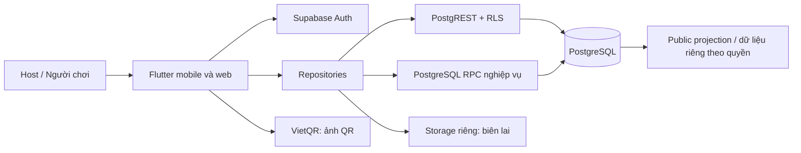

# Kiến trúc tổng thể — đặc tả đích

> **Hiện hành 20/10/2026:** Giữ Flutter/Provider/Supabase và lớp typed hiện có; không dựng lại scaffold BH-01..06. BH-06 Đạt tích hợp local tại `318bc52` ([review](reviews/bh06/review_318bc52.md)), đã merge vào main tại `e7f7627`; docs/ai đã có trên main (`eaeb209`). Baseline review: analyze sạch, 190 Flutter +335 DB, 7 tích hợp +3 nâng cấp +2 probe PASS. BH-07A **Đạt phần A local tại `4512c3a`** theo [review độc lập](reviews/bh07/review_4512c3a.md); B/C/D và pilot chưa nghiệm thu, không tự chuyển phần tiếp theo. Chưa nghiệm thu HTTP/JWT/Auth thật, thiết bị/ngân hàng thật, staging/production, backup/restore hoặc concurrency HTTP; merge code không phải deploy.

Phiên bản 1.1 · 14/10/2026. Giữ Flutter/Dart, Provider, Supabase PostgreSQL/Auth/Storage. Phiên bản SDK thực tế lấy từ pubspec và toolchain đã xác minh, không tự nâng SDK theo tài liệu.

## 1. Sơ đồ hệ thống



MVP không cần backend riêng. SQL transaction/RPC xử lý các thao tác cần đồng thời hoặc liên quan nhiều bảng. Edge Function chỉ khi cần chức năng không nên chạy trong client: webhook, tích hợp bên ngoài hay khách tự phục vụ; chưa phải phụ thuộc MVP.

## 2. Ranh giới module

| Module | Trách nhiệm |
|---|---|
| Auth | Phiên tài khoản, khôi phục mật khẩu, hồ sơ |
| Clubs | Quyền CLB, thành viên, liên hệ riêng, tài khoản nhận tiền |
| Sessions | Lịch, chia sẻ, đăng ký, duyệt/chờ/hủy, điểm danh |
| Finance | Chi phí, chốt khoản phải thu, thanh toán, sổ quỹ |
| Venues | Danh bạ sân và chọn sân |
| Court tools (sau MVP) | Trận, xoay tua, bảng điểm, giao lưu |

Chi tiết session sử dụng các module trên qua repository/provider, không tự gọi Supabase. Không tạo chung một biến currentSession cho mọi route nếu có thể mở nhiều buổi; provider chi tiết gắn sessionId và được dispose theo route.

## 3. Cấu trúc thư mục

```text
lib/
  main.dart                     # bootstrap, provider gốc
  core/
    app_constants.dart          # cấu hình public, không secret
    vietqr_helper.dart
    routing/                    # route ID, login return URL
    money/                      # chia phí/định dạng thuần Dart
  models/                       # model typed, enum, fromJson/toJson
  data/
    supabase_service.dart       # tương thích tạm thời trong refactor
    auth_repository.dart
    club_repository.dart
    session_repository.dart
    finance_repository.dart
    venue_repository.dart
  providers/
    auth_provider.dart
    club_provider.dart
    session_provider.dart
    session_detail_provider.dart
    finance_provider.dart
  screens/                      # tổ chức theo màn hình, tách widget khi cần
    ...
  widgets/                      # widget dùng chung có nhu cầu thực
supabase/
  migrations/                   # migration versioned, chỉ tạo khi triển khai BH-02
  tests/                        # quyền/RPC/concurrency
  seed.sql                      # dữ liệu giả local/staging
test/                          # tests Flutter/Dart
 docs/
```

Các thư mục/file mới là đích cho từng backlog, không yêu cầu tạo scaffold rỗng hàng loạt. Giữ Provider; chỉ thêm thư viện khi có yêu cầu thực và đã thống nhất với chủ dự án. Không chuyển framework state management trong MVP.

## 4. Luồng dữ liệu

Screen → Provider → Repository → DB/API → Model typed → Provider → Screen. Screen sở hữu form, provider sở hữu trạng thái nghiệp vụ. Repository nhận client qua constructor để test và không phụ thuộc widget context. Hàm chia tiền/xoay tua độc lập với network.

Read: public projection hoặc bảng/view được RLS bảo vệ. Write đơn giản: DB validation + RLS. Write nhạy cảm: RPC có quyền gọi giới hạn, kiểm tra auth.uid(), vai trò, vòng đời và input; khóa đúng hàng để tránh đua. Client không truyền currentBalance/currentJoined làm nguồn tính toán.

## 5. Điều hướng và state

Host: Tổng quan / Buổi chơi / CLB / Tài khoản. Route chia sẻ `/sessions/:id`; CLB `/clubs/:id`; các màn hình quản trị chỉ hiện khi có quyền. Login giữ return URL hợp lệ nội bộ, tránh chuyển hướng tùy ý. Public session không cần tải danh sách liên hệ/tài chính.

State đọc: loading, data, empty, error. State ghi: idle, submitting, success, error. Khi đổi route, xóa dữ liệu cũ; kết quả request đến trễ không được ghi vào route mới. Kiểm tra mounted trước setState/sử dụng context; dispose controller/subscription. Không có read error mà báo thao tác đã thành công.

MVP tải lại sau ghi và khi trở lại màn hình; chống slot vẫn do DB. Realtime có thể thêm sau, không cần để đảm bảo đúng dữ liệu. Khi dùng realtime, quyền phải tương đương read và subscription gắn vòng đời màn hình.

## 6. Hạ tầng và cấu hình

- Tách local/staging/production theo cấu hình public build; không hardcode môi trường production cho tests.
- Public Supabase URL/key có thể ở client; service-role, database password, secrets chỉ ở server/CI có quyền.
- Auth cấu hình email confirmation, reset URL, mobile/web callback theo môi trường. Deep link và phục hồi sau login phải kiểm thử thật.
- Storage receipts là private bucket, signed URL ngắn hạn cho người có quyền; giới hạn loại/kích thước file, không đưa biên lai vào bucket public. Biên lai upload là phần bổ sung khi cốt lõi payment đã ổn định.
- VietQR lấy tài khoản của host/CLB đã xác minh cấu hình; không có account thì báo cần thiết lập. Mã QR không phải tín hiệu thanh toán.
- Migration có thứ tự, review và rehearsal với dữ liệu mẫu; backup trước triển khai. SQL cũ không được xem là migration của kiến trúc mới.

## 7. Khả năng quan sát và kiểm thử

Log mã lỗi, operation/request ID, thời gian; không log JWT, SĐT, tài khoản hoặc biên lai. Ghi audit ở DB cho quyền, thay đổi lịch, chốt phí, thu/chi. Test đơn vị cho chia tiền/vòng đời; test DB cho RLS/RPC/đua slot; widget/integration test cho một buổi hoàn chỉnh. `flutter analyze`, test liên quan và DB test chạy theo phạm vi thay đổi; CI không chạm production.

## 8. Quyết định kiến trúc

- ADR-01: giữ stack hiện tại để giảm chi phí học và chuyển đổi.
- ADR-02: DB là nơi đảm bảo quyền và số liệu; UI chỉ là trải nghiệm.
- ADR-03: phân quyền theo CLB và session, không dùng global host boolean.
- ADR-04: ledger là nguồn số dư, charges + confirmed payments là nguồn công nợ.
- ADR-05: MVP không ghi offline, không tích hợp ngân hàng tự động.
- ADR-06: schema tài liệu là hợp đồng đích; migration được viết/kiểm thử trong BH-02, không áp dụng tự động chỉ vì có tài liệu.

## 9. ADR và yêu cầu sau review v1.1

[11_ARCHITECTURE_DECISIONS.md](11_ARCHITECTURE_DECISIONS.md) chứa context, phương án, quyết định và chi phí của ADR-01 đến ADR-09. Các nhãn ADR ở phần 8 là tóm tắt, bản chi tiết ở file 11 là nguồn chuẩn.

Giữ module trong một app/một DB. Không thêm backend hay đầy đủ domain/use-case/port/adapter cho mọi CRUD. Transaction DB bảo vệ đăng ký và tiền; thông báo tương lai có thể async nhưng không quyết định nguồn số liệu. Billing freshness dựa trên phiên bản input/revision. Projection/UI phải thể hiện stale và server chặn thao tác thu/complete. Lời mời waitlist có trạng thái lưu tại DB, không chỉ biến state màn hình.

## 10. Áp dụng nghiên cứu ứng dụng tương tự

Theo [14_PRODUCT_LEARNINGS_VMITO_VUT.md](14_PRODUCT_LEARNINGS_VMITO_VUT.md): giữ Flutter/Provider/Supabase và transaction/RLS hiện tại. Không suy service architecture từ URL strings hoặc tích hợp chat/maps/push chỉ vì report có thư viện. Deep link và return route validation ở app boundary; server tiếp tục kiểm quyền ID. GPS/map SDK không là phụ thuộc MVP; external map link/manual area đủ bước đầu. Release kiểm merged manifest/exported components/backup/token persistence thật theo platform. Không thay schema/migration trong lượt nghiên cứu; notifications/devices chỉ thiết kế khi ticket sau pilot được giao.
