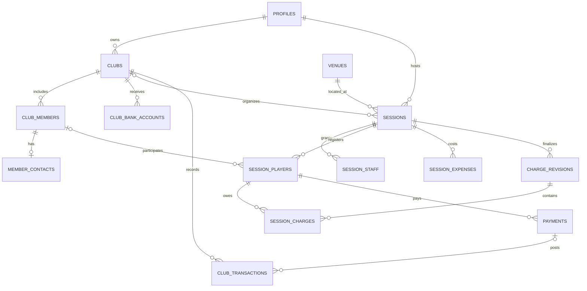

# Cơ sở dữ liệu — mô hình đích v1.1

> **Hiện hành 16/10/2026:** Đây là mô hình đích; migration BH-02..05 đã có và đã kiểm PostgreSQL cô lập, chưa xác nhận schema live. Tài chính BH-06 chưa triển khai đầy đủ. BH-05 đạt review tích hợp tại `d769531`; hồi quy main `3a34883`: analyze sạch, 137 Flutter + 251 DB. Tiếp theo BH-06. Chỉ kiểm thử local/PostgreSQL cô lập; chưa apply staging/production, chưa HTTP/JWT thật, thiết bị/browser e2e, backup/restore hoặc concurrency qua HTTP. [Trạng thái và xác nhận sau audit](23_DOC_AUDIT_FOLLOWUP.md).

14/10/2026 · PostgreSQL/Supabase. Đây là thiết kế để viết migration BH-02, chưa phải mô tả schema live. SQL cũ 05/06 không đủ để tạo hệ thống này.

## 1. Quy ước

UUID cho PK, gen_random_uuid(); created_at/updated_at timestamptz, now() và trigger updated_at tại DB. Thời gian hiển thị Asia/Ho_Chi_Minh. Tiền bigint nguyên VNĐ, >= 0; khoản thu/chi thực > 0. DTO phải kiểm tra miền giá trị biểu diễn chính xác trên Flutter web (giới hạn an toàn 2^53−1); đặt giới hạn nghiệp vụ nhỏ hơn tại DB. V1 đề xuất tối đa 1.000.000.000 VNĐ mỗi khoản, các tổng kiểm tra cùng giới hạn cho pilot.

Tất cả FK được index theo nhu cầu truy vấn, không mặc định FK có index. CHECK/NOT NULL/UNIQUE phải nằm trong migration, không chỉ Flutter. Trạng thái dùng text + CHECK hoặc enum PostgreSQL thống nhất; không lấy nhãn UI tiếng Việt làm giá trị lưu.

## 2. Quan hệ

## 3. Từ điển bảng MVP

### profiles và profile_private

`profiles`: id UUID PK → auth.users.id; display_name text NOT NULL; avatar_path nullable; skill_level text nullable (thang phong trào hiển thị, không coi là Elo xác thực); created_at/updated_at. Hồ sơ không tự công khai toàn bộ bảng, chỉ projection các trường cho phép.

`profile_private`: user_id UUID PK → profiles; phone_number text nullable. Chỉ chủ tài khoản đọc/sửa; host không tự truy vấn bảng này. Người chơi chủ động cung cấp contact cho từng đăng ký. Không dùng SĐT làm ID hay bằng chứng account.

### clubs

id PK; owner_user_id UUID NOT NULL → profiles; name text NOT NULL; description nullable; visibility (`private`,`public`), default private; status (`active`,`archived`); created_at/updated_at. Owner là nguồn quyền cao nhất và phải có club_members active tương ứng; tạo/chuyển owner trong transaction. Không lưu balance do client cập nhật; số dư là tổng ledger.

### club_members và member_contacts

`club_members`: id PK; club_id FK NOT NULL; user_id FK nullable; display_name NOT NULL; role (`owner`,`host`,`treasurer`,`member`); status (`invited`,`active`,`inactive`); joined_at nullable; created_at/updated_at. UNIQUE (club_id,user_id) WHERE user_id IS NOT NULL; tối đa một role owner active mỗi CLB. Thành viên không account vẫn có id và tên, nhưng role có quyền chỉ có hiệu lực khi user_id được xác nhận. Không xóa thành viên đã có lịch sử, chuyển inactive.

`member_contacts`: member_id PK FK; phone_number nullable; contact_note nullable; updated_at. Owner/host được đọc phục vụ vận hành, member liên kết được đọc bản ghi của mình; treasurer không có quyền contact mặc định. Payload danh sách công khai không join bảng này.

### club_bank_accounts / host_bank_accounts

Mỗi bảng: id PK; club_id hoặc user_id FK NOT NULL; bank_code, account_number, account_name text NOT NULL; status (`active`,`inactive`); created_at/updated_at. V1 chỉ một tài khoản active cho mỗi CLB/host (partial UNIQUE). Chủ CLB/host cấu hình tài khoản; người chơi confirmed chỉ nhận thông tin thanh toán cần thiết qua projection trong buổi liên quan. Không public SELECT bảng gốc.

### venues

id PK; name/address NOT NULL; area, phone_number, map_url, image_url nullable; court_count integer CHECK > 0 nếu có; price_range nullable chỉ là giá tham khảo; status (`active`,`inactive`); created_at/updated_at. Public read sân active qua projection. Ghi danh bạ qua quyền quản trị riêng, không vì là host mà được sửa sân chung.

### sessions

id PK; club_id FK nullable; host_user_id FK NOT NULL; venue_id FK NOT NULL; title NOT NULL; description nullable; starts_at/ends_at timestamptz NOT NULL; capacity integer NOT NULL > 0; court_count integer NOT NULL > 0; level_requirement nullable; visibility (`private`,`unlisted`,`public`), default unlisted; lifecycle (`draft`,`published`,`in_progress`,`completed`,`cancelled`); approval_mode (`host_approval`,`auto_confirm`); fee_mode (`fixed`,`split_actual`); member_fee_vnd/guest_fee_vnd bigint >= 0 nullable chỉ khi split; registration_deadline/cancellation_deadline timestamptz; receiver_club_bank_account_id hoặc receiver_host_bank_account_id FK; receiver_snapshot jsonb nullable; version bigint NOT NULL default 1; billing_input_version bigint NOT NULL default 1 CHECK > 0; created_at/updated_at.

CHECK ends_at > starts_at, registration_deadline <= ends_at, cancellation_deadline <= starts_at. Fixed yêu cầu đủ hai mức phí. Receiver phải thuộc đúng CLB/host; snapshot được chốt khi publish/chốt phí và chỉ qua API riêng cho người có quyền. Không expose snapshot trên public row. Thay ngân hàng sau khi đã thu cần xác nhận rõ và audit; không đổi mã tham chiếu của payment.

Public/unlisted không cho SELECT gốc chứa trường riêng. Private: chỉ staff/thành viên active CLB liên quan và người đã có đăng ký; một UUID hoặc link không tự cấp quyền. Unlisted: không nằm trong feed, đọc thông tin tối thiểu bằng RPC theo ID; không coi link là bí mật bảo vệ dữ liệu riêng.

Không lưu joined_count do client tính. Counts/còn chỗ tính từ confirmed tại DB. Cập nhật version để chống ghi đè cấu hình cũ.

### session_staff

id PK; session_id FK; user_id FK; role (`cohost`,`finance`); status (`active`,`inactive`); UNIQUE(session_id,user_id,role). Host có thể phân công cùng một người hai role. Chỉ host/owner cấp quyền; cohost không tự cấp finance. Quyền CLB treasurer chỉ tài chính, không sửa lịch/đăng ký.

### session_players / session_player_contacts

`session_players`: id PK; session_id FK NOT NULL; user_id FK nullable; club_member_id FK nullable; display_name NOT NULL snapshot; registration_status (`pending`,`confirmed`,`waitlisted`,`cancelled`,`rejected`); attendance_status (`not_checked_in`,`present`,`no_show`); source (`self`,`host`); participant_type (`member`,`guest`); fee_exempt boolean default false; agreed_fee_vnd bigint nullable; requested_at timestamptz; confirmed_at/cancelled_at/checked_in_at nullable; checked_in_by FK nullable; created_by FK NOT NULL; created_at/updated_at.

Ít nhất có user_id hoặc club_member_id cho self; host-added guest có thể thiếu cả hai nhưng luôn có player id. Nếu cả hai có thì phải là cùng người và đúng CLB; RPC kiểm tra điều này. UNIQUE(session_id,user_id) WHERE user_id IS NOT NULL; UNIQUE(session_id,club_member_id) WHERE club_member_id IS NOT NULL. Host-added guest được phân biệt bằng ID/request key, không gộp tự động theo tên/phone. Liên kết account về sau phải chống hai đăng ký cùng người trong cùng buổi và được host/người dùng xác nhận.

`session_player_contacts`: player_id PK FK; phone_number nullable; updated_at. Host/cohost quản lý buổi đọc; người liên kết đọc/sửa của mình qua RPC; finance không đọc contact mặc định. Không trả contacts cho người chơi khác.

attendance present/no_show chỉ hợp lệ với confirmed, ghi qua RPC; người có khoản thu/đã điểm danh không được hủy như đăng ký bình thường. Miễn phí hoặc sửa phí phải do quyền tài chính/owner, audit; một cohost chỉ vận hành không tự miễn tiền.

### session_expenses

id PK; session_id FK; category (`court`,`shuttle`,`other`); title text NOT NULL; amount_vnd bigint > 0; status (`posted`,`reversed`); created_by FK; posted_at; reversal_reason nullable; created_at/updated_at. Ghi posted cho buổi CLB phải tạo ledger entry chi cùng transaction. Reverse phải đảo ledger trong cùng transaction; không xóa vật lý. Đã có charge finalization thì sửa chi phí đánh dấu cần chốt lại.

### charge_revisions và session_charges

`charge_revisions`: id PK; session_id FK; revision_no integer > 0; source_version bigint NOT NULL CHECK > 0; status (`active`,`superseded`); allocation_total_vnd bigint >= 0; fee_mode snapshot; reason nullable; finalized_by FK; finalized_at timestamptz. UNIQUE(session_id,revision_no), partial UNIQUE(session_id) WHERE status='active'. Revision đầu không yêu cầu lý do; revision sau bắt buộc lý do.

`session_charges`: id PK; revision_id FK; session_player_id FK; amount_due_vnd bigint >= 0; reason nullable; created_at; UNIQUE(revision_id,session_player_id). Player phải thuộc cùng session với revision, kiểm tra DB trigger/RPC. Có bản ghi 0 cho người được miễn phí, không bỏ mất dấu vết. Charge đã chốt immutable; tạo revision mới. Tất cả khoản thu chỉ bắt đầu sau finalization trong MVP.

### payments

id PK; session_player_id FK; amount_vnd bigint > 0; method (`cash`,`bank_transfer`); status (`submitted`,`confirmed`,`rejected`,`reversed`); reference text NOT NULL UNIQUE; receipt_path nullable; submitted_by FK; confirmed_by FK nullable; confirmed_at nullable; reason nullable; created_at/updated_at.

Payment gắn player, không gắn charge revision để re-finalize vẫn đối chiếu toàn bộ tiền đã thu. active revision là nguồn phải thu. Nếu cần audit charge tại thời điểm nộp, lưu submitted_revision_id FK. MVP không nhận vượt outstanding; DB khóa player/session và kiểm tra tổng confirmed. Rejected không cộng tiền; reversed tạo bút toán đảo trong ledger và audit, không xóa bản ghi. Cách chuẩn v1: chuyển payment confirmed → reversed, ledger đảo bằng reversal_of entry; không tạo payment đảo riêng. confirmed_by/confirmed_at được giữ để truy vết, bổ sung reversed_by/reversed_at/reversal_reason khi đảo.

### club_transactions

id PK; club_id FK; direction (`income`,`expense`); amount_vnd bigint > 0; title NOT NULL; source_type (`manual`,`payment`,`session_expense`,`reversal`); source_payment_id FK nullable; source_expense_id FK nullable; reversal_of UUID nullable → club_transactions; created_by FK; created_at. Không sửa/xóa entry đã ghi. UNIQUE(source_payment_id) WHERE source_type='payment'; UNIQUE(source_expense_id) WHERE source_type='session_expense'; UNIQUE(reversal_of) WHERE reversal_of IS NOT NULL. CHECK nguồn đúng loại và FK source phải thuộc CLB; entry đảo ngược direction, cùng amount/club với bản gốc.

Số dư = SUM(income) − SUM(expense) gồm cả bút toán đảo. Không có cột balance độc lập trong nguồn chuẩn. Số dư ban đầu nhập như manual income/expense với lý do chuyển đổi, không vừa backfill lịch sử vừa cộng opening balance của cùng kỳ.

### audit_events và operation_requests

`audit_events`: id PK; actor_user_id FK nullable khi hệ thống; club_id/session_id nullable; entity_type/entity_id; action; old_state/new_state jsonb đã lọc dữ liệu riêng; reason nullable; request_id nullable; created_at. Ghi ở DB trong cùng transaction, append-only; người vận hành chỉ xem audit phù hợp quyền. Không ghi JWT/SĐT/account/receipt vào JSON audit.

`operation_requests`: actor_user_id FK; operation text; request_id UUID; payload_hash text; result jsonb; created_at; PRIMARY KEY(actor_user_id,operation,request_id). Ghi cùng transaction để retry không lặp; cùng key khác payload trả conflict. Không public đọc bảng; result phải được kiểm tra quyền khi replay, và không chứa dữ liệu nhạy cảm quá mức. Chính sách dọn key phải dài hơn cửa sổ retry được công bố; MVP giữ ít nhất 30 ngày.

## 4. Views/projections và index

- `public_session_summary`: title/sân/ngày/trình độ/phí dự kiến/slot/host display name; không contact participant, bank snapshot, ledger. Chỉ public published/in_progress; RPC riêng cho unlisted theo ID.
- `club_balance`: tổng ledger cho owner/treasurer, không public.
- `player_outstanding`: active charges − confirmed payments theo player; player xem của mình, finance xem buổi thuộc quyền. Outstanding không âm ở MVP.
- Các view phải giữ quyền người gọi (security_invoker nếu thích hợp) hoặc dùng RPC whitelist trường với authorization rõ; view chạy quyền owner không được vô tình vượt RLS.
- Index: sessions(club_id,starts_at), sessions(lifecycle,visibility,starts_at), session_players(session_id,registration_status), club_members(user_id,club_id,status), expenses(session_id), revisions(session_id,status), payments(session_player_id,status), transactions(club_id,created_at), audit(session_id,created_at).

## 5. Ma trận phân quyền

| Hành động | Owner CLB | Host buổi/cohost | Treasurer/finance | Member/player | Anonymous |
|---|---|---|---|---|---|
| Cấu hình CLB/vai trò | Có | Không; host CLB chỉ vận hành | Không | Không | Không |
| Danh sách CLB nội bộ | Có | Host CLB: có | Theo nhu cầu quỹ | Member: tên, không contact người khác | Không |
| Tạo/sửa buổi CLB | Có | Host CLB tạo; host/cohost buổi sửa | Không | Không | Không |
| Duyệt/hủy/điểm danh | Có | Buổi được quản lý | Không | Chỉ yêu cầu/hủy riêng theo hạn | Không |
| Phí/thu/chi buổi | Có | Host chính: có; cohost cần finance | Có, trong CLB/buổi được giao | Chỉ xem/nộp khoản riêng | Không |
| Quỹ CLB | Có | Không nếu thiếu role treasurer | Treasurer CLB: có | Không mặc định | Không |
| Đọc công khai | Có | Có | Có | Có | Projection public/unlisted |
| Sửa danh bạ sân | Quyền admin riêng | Quyền admin riêng | Quyền admin riêng | Không | Không |

Owner CLB có quyền quản trị mọi buổi CLB. Host chính buổi có quyền tài chính buổi nhưng không tự quản trị quỹ/manual transactions CLB. DB tự post nguồn từ buổi vào quỹ, không cần cấp host SELECT toàn bộ quỹ. Club host được tạo buổi, không mặc định quản trị mọi buổi do host khác tổ chức; cần session_staff. Owner chuyển quyền và cấp staff trong RPC kiểm tra người gọi; không cho update role/owner trực tiếp.

Tất cả bảng bật RLS. Anonymous không có INSERT/UPDATE/DELETE bảng nghiệp vụ. Người đăng nhập cũng không có direct write bảng nguồn của slot/finance/role; cấp EXECUTE RPC cần thiết và SELECT hạn chế. Helper kiểm tra membership tránh RLS recursion; SECURITY DEFINER chỉ khi cần, search_path cố định, tên schema đầy đủ, revoke EXECUTE PUBLIC và kiểm tra auth.uid() bên trong. Không cho client giả actor/confirmed_by. Tài khoản admin danh bạ qua bảng app_roles được bảo vệ, chỉ cấp qua quy trình vận hành tin cậy, không metadata do user tự sửa.

## 6. Migration từ code cũ

1. Kiểm kê schema/grants/policies/functions live ở staging, backup và rehearsal. Không suy luận live từ SQL repo.
2. Tạo bảng/fields đích bổ sung; dữ liệu cũ giữ nguyên để đối chiếu. Mapping sân theo bảng xác nhận, không match tên mơ hồ tự động.
3. Host xác nhận quyền sở hữu CLB/session; bản ghi chưa xác nhận nằm diện cách ly, không public tài chính/liên hệ. Không coi owner_phone là xác thực.
4. Chuyển người chơi thành ID ổn định; giữ has_arrived/has_paid cũ để đối chiếu. has_paid=true không đủ để dựng amount/method/confirmed_by chính xác; cần reconciliation host trước tạo payments đã xác nhận.
5. Quỹ: chọn chuyển đủ lịch sử hoặc opening balance tại mốc được xác nhận; không cộng hai cách. joined_count cũ đối chiếu đăng ký, không nhập làm nguồn đích.
6. Viết migration forward, RLS/RPC/tests, staging smoke test; chuyển client và thu hồi policy mở trong một kế hoạch release có điểm dừng/khôi phục. Không triển khai schema chưa có client tương thích lên production đang dùng.
7. Sau đối chiếu mới loại bỏ cột/bảng legacy. Rollback bảo toàn ledger/payments đã phát sinh, không drop chúng để về schema cũ.

## 7. Mô hình giai đoạn sau

session_templates chỉ lưu cấu hình; matches(session_id,court_no,status), match_players(match_id,player_id,team), match_results versioned; challenges(match_id,item,quantity,status) và participants theo ID. Người đang playing không vào hai sân; số trận chỉ tăng sau kết thúc xác nhận. Elo/statistics là projection từ kết quả, không theo tên tự do. Các bảng này chưa thuộc migration MVP bắt buộc.

## 8. Bản chốt phí và lời mời danh sách chờ (v1.1)

### Phiên bản dữ liệu tính phí

sessions.billing_input_version do DB tăng, client không được đặt. charge_revisions.source_version là snapshot phiên bản mà DB đã tính. `billing_state` là projection: chưa có revision → unfinalized; active.source_version != session.billing_input_version → stale; bằng nhau → current. Không lưu một cờ needs_refinalization độc lập có thể lệch nguồn.

Tăng phiên bản trong cùng transaction khi thêm/đảo posted expense, thay đổi attendance, confirmed roster (kể cả khách sau chốt), agreed_fee/exemption/fee_mode hoặc thông tin khác thay đổi tập người/số tiền phải thu. Không tăng khi chỉ đổi contact/tên hiển thị/ghi chú hay xác nhận payment; payment không làm thay đổi amount_due. Cập nhật receiver dùng quy trình riêng, không trộn với phiên bản phép chia phí. Với thay đổi roster sau chốt, dùng quyền finance hoặc báo cần finance xử lý; cohost chỉ vận hành không tự thay tài chính đã chốt.

finalize giữ lock session và input liên quan, kiểm tra expected_billing_input_version, tạo active revision có source_version khớp trong cùng transaction. Tất cả charges bao phủ người present, kể cả 0; người không chịu phí nhưng đã có confirmed payment không được bỏ mất khỏi kiểm tra đối chiếu. Nếu giảm due dưới số đã thu, báo cần xử lý trước, không tự đảo thanh toán thật.

### waitlist_invitations

id UUID PK; session_player_id UUID FK NOT NULL; invited_by UUID FK profiles NOT NULL; invited_at timestamptz NOT NULL; expires_at timestamptz NOT NULL; status (`pending`,`accepted`,`revoked`,`expired`); accepted_by UUID FK nullable; accepted_at nullable; acceptance_mode (`self`,`host_recorded`) nullable; consent_note text nullable; revoked_by UUID FK nullable; revoked_at nullable; created_at/updated_at.

CHECK expires_at > invited_at. Partial UNIQUE(session_player_id) WHERE status='pending'; index(session_player_id,status,expires_at). RPC trước khi tạo invitation mới phải chuyển pending đã quá giờ sang expired trong cùng transaction. Trạng thái hết hạn tính từ thời gian DB, không chờ cron mới có hiệu lực. Expires_at không vượt deadline đăng ký/starts_at. Không chứa secret token vì MVP nhận theo account player, không self-service guest token.

Chỉ host/cohost đúng session được mời/thu hồi. Player linked xem lời mời của mình. Guest không account: host/cohost ghi nhận đồng ý bằng consent_note và audit khi accept thay; không cho account khác tự accept guest. Accept/revoke/cancel khóa session → player → invitation; kiểm tra invitation player thuộc session và quyền người gọi, status/time, vòng đời và slot. Accepted không giữ slot riêng: chuyển player thành confirmed cùng transaction. Hủy player/buổi thu hồi pending invitations; revoke sau accepted dùng luồng cancel registration với quy tắc tương ứng.

### Cổng quyền và schema

Chỉ có table grant hoặc RLS enabled chưa chứng minh quyền đúng. Migration/tests phải kiểm tra grants + policy + RPC execution + payload projection; anon không đọc phone/has_paid, không insert flags; authenticated không sửa player khác. Bổ sung migration tạo clubs/club_transactions trước khi client gọi các bảng đó; không chạy SQL legacy để lấp schema thiếu. Tests dùng role app, không lấy postgres admin làm kết quả nghiệm thu quyền.

## 9. Ghi chú nghiên cứu Vmito/Vụt

Báo cáo tĩnh được dùng như tham khảo UX/quality, không phải schema/API để sao chép. Không thay đổi mô hình đích v1.1 trong lượt này. Filter MVP dùng venues.area và trường sessions hiện có qua projection theo quyền, count confirmed do DB tính đúng; member/pending không nhận receiver_snapshot từ bảng gốc. Push/device preferences hoặc tọa độ near-me chưa thuộc schema bắt buộc; chỉ thêm migration riêng sau khi có use case và quyết định triển khai. Chi tiết [14_PRODUCT_LEARNINGS_VMITO_VUT.md](14_PRODUCT_LEARNINGS_VMITO_VUT.md).
