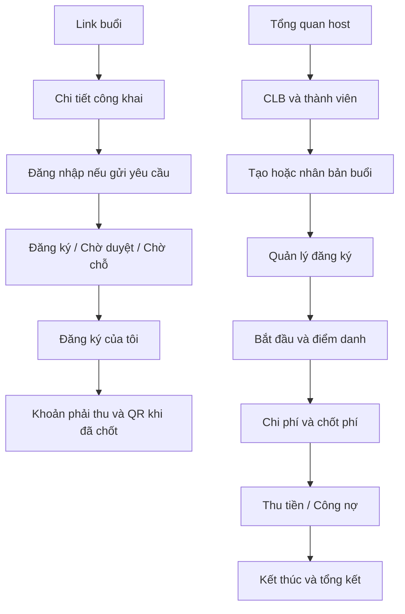

# Luồng màn hình và nội dung UI

Đặc tả v1.1, ưu tiên mobile. Màu/theme hiện tại có thể giữ; tập trung rõ trạng thái và hành động.

## 1. Điều hướng

Host: **Tổng quan · Buổi chơi · CLB · Tài khoản**. Người chơi vào trực tiếp link buổi, có mục Lịch của tôi và Khoản phải đóng của tôi. Quyền thay đổi theo CLB/buổi; không yêu cầu chọn global host/player để truy cập.

## 2. Màn hình

| Màn hình | Nội dung / hành động chính |
|---|---|
| Tổng quan host | Buổi sắp tới/đang chơi, yêu cầu chờ duyệt, khoản chưa thu thuộc quyền; tạo buổi; không banner che hành động |
| Danh sách buổi | Lọc CLB/ngày/trạng thái; tab sắp tới/lịch sử; tạo/nhân bản; label còn chỗ tách lifecycle |
| Form buổi | Chọn CLB hoặc buổi độc lập, sân từ danh bạ, ngày/giờ, số sân, capacity, trình độ, phí member/guest hoặc split, deadline, visibility, approval |
| Chi tiết công khai | Tên host/CLB, sân/map, ngày/giờ, trình độ, số chỗ, phí dự kiến/quy tắc, nút đăng ký; không contacts/ngân hàng/người tham gia khác |
| Đăng ký của tôi | Status rõ pending/confirmed/waitlisted; hủy đúng hạn, contact riêng, phí đã thống nhất; nếu chờ duyệt không ghi 'đã giữ chỗ' |
| Quản lý buổi | Tabs Đăng ký / Điểm danh / Thu chi / Tổng kết; tab tiền theo quyền; thêm người từ CLB hoặc guest; danh sách trạng thái |
| Điểm danh | Chỉ confirmed, present/no_show/chưa điểm danh, thêm khách trực tiếp; bắt đầu buổi; count không thay thế danh sách |
| Chốt phí | Chi phí thực tế, người present/exempt, preview server-calculated, lý do adjustment, xác nhận; version conflict yêu cầu tải lại |
| Thu tiền | Mỗi người: phải thu/đã thu/còn nợ, khoản submitted, xác nhận/reject, cash; QR cho đúng player, số outstanding và mã tham chiếu |
| CLB | Tên/cấu hình, thành viên, lịch, quỹ theo quyền; không hiện quỹ cho mọi member mặc định |
| Sổ quỹ | Balance server, lọc thu/chi, nguồn liên kết, manual entry/đảo có lý do; không sửa trực tiếp balance |
| Tài khoản | Tên/trình độ, ngân hàng host cá nhân, đổi/khôi phục mật khẩu, đăng xuất |
| Tổng kết | Số người present, chi phí, khoản phải thu/đã thu/còn nợ; copy nội dung gửi nhóm đã bỏ contacts/private details |

## 3. Validation và trạng thái

Tên bắt buộc/trim, không giá trị mặc định giả cho phone/account; ngày/giờ picker và error tại trường. Nhãn phí ghi 'dự kiến' nếu chưa chốt, 'phải đóng' sau chốt; 'đã gửi thông tin chuyển khoản' khác 'đã xác nhận thu'. Buổi fixed và split phải trình bày cách tính trước đăng ký.

Nút mutation disable khi submitting nhưng timeout vẫn có retry cùng request_id. Error giải thích cách sửa/thử lại; empty nêu hành động phù hợp (tạo buổi, thêm thành viên). Không spinner vô hạn sau lỗi. Dữ liệu cũ có nhãn chưa cập nhật, không hiển thị thành dữ liệu mới.

Confirm dialog cho cancel buổi, đổi lịch đã có người đăng ký, chốt lại phí, đảo thanh toán/quỹ và thay người nhận tiền; nêu tác động cụ thể. Không yêu cầu confirm cho mọi click nhỏ. Các thao tác không có quyền không hiện nút; server vẫn phải chặn.

## 4. Kênh chia sẻ

MVP hỗ trợ copy link/nội dung để host tự gửi Zalo/Facebook, không tự gửi tin cho người khác. Link chứa session ID, không SĐT, bank hoặc token tài khoản. Unlisted không nằm feed, private vẫn phải login/quyền. Auth callback quay lại buổi đang xem. Thông báo thay đổi là banner/activity trong app; push, SMS, tích hợp Zalo API chưa thuộc MVP.

## 5. Công cụ trên sân sau pilot

Bảng điểm, xoay tua và giao lưu mở từ session in_progress, dùng danh sách present. Không yêu cầu nhập lại danh sách người bằng tên tự do. Xoay tua cho host xem gợi ý trước xác nhận; có manual override. Kèo giao lưu được đồng ý trước trận, lưu vật phẩm/số lượng/participant IDs; sửa/undo kết quả không tạo khoản trùng. Quy tắc bảng điểm phải ghi phiên bản/thể thức; không tự gắn nhãn chuẩn BWF khi chưa kiểm tra luật áp dụng.

## 6. UI bổ sung từ review v1.1

- billing_state=stale: banner "Dữ liệu tính phí đã thay đổi, cần chốt lại"; chỉ xem bản cũ với nhãn lịch sử; disable QR/nộp/confirm/cash/complete, server cũng chặn. Nút Chốt lại chỉ cho finance, hiện lý do và phần đã thu.
- Waitlist: người chơi thấy chưa được mời hoặc lời mời có thời hạn và nút chấp nhận. Host có Mời/Thu hồi; lời mời không hứa giữ slot. Guest chưa account: host ghi nhận đồng ý, không tạo login giả.
- Form ngày/giờ phải dùng giá trị đã nhập, kể cả ngày mai/qua nửa đêm; không gán literal giờ hoặc DateTime.now() làm ngày mọi buổi.
- Schema chưa có, permission denied và lỗi mạng là error có retry, không empty. Các switch điểm danh/thu tiền chỉ thay state sau kết quả RPC; refresh cũng cần handling và kiểm tra route còn mounted.
